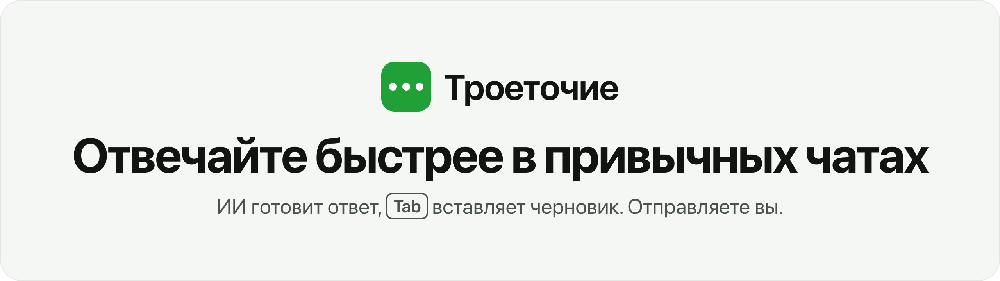
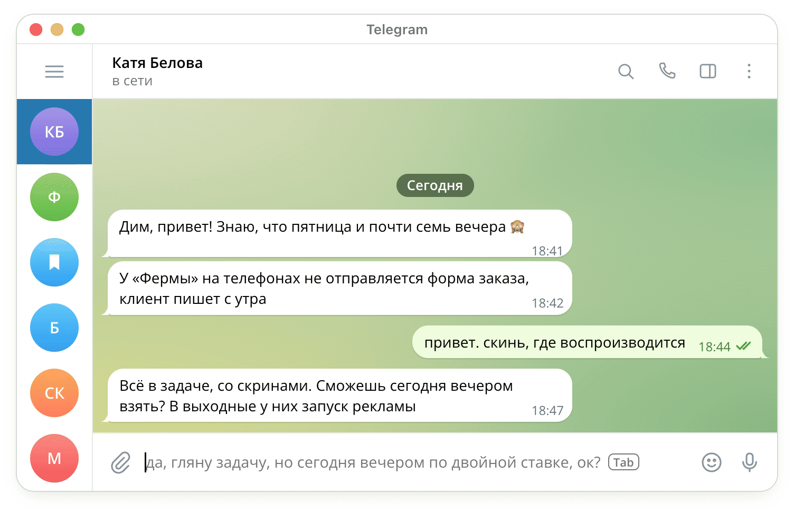

<div align="center">

<picture>
  <source media="(prefers-color-scheme: dark)" srcset="docs/banner-dark.png">
  
</picture>

[](https://github.com/troetochie-online/troetochie/releases/latest)
[](https://github.com/troetochie-online/troetochie/releases)
[](https://apps.apple.com/app/id6824260050)
[](https://troetochie.com)
[](https://troetochie.com)

<picture>
  <source media="(prefers-color-scheme: dark)" srcset="docs/inline-demo-dark.gif">
  
</picture>

<a href="https://github.com/troetochie-online/troetochie/releases/latest/download/Troetochie.dmg"></a>&nbsp;
<a href="https://troetochie.com/downloads/Troetochie-Windows-setup.exe"></a>&nbsp;
<a href="https://apps.apple.com/app/id6824260050"></a>

<sub>macOS 14+ · Windows 10 22H2+, бета · iOS 16+ · без регистрации и банковской карты</sub>

</div>

## Как это работает

1. **Ставите курсор в пустое поле чата.** Троеточие читает видимую переписку над полем. В Telegram ответ готовится заранее, пока чат открыт.
2. **Ответ появляется серым прямо в поле**, шрифтом и цветом самого приложения. Его можно показывать и на пилюле над курсором, тогда «Запись экрана» не нужна.
3. **Tab вставляет черновик.** Его можно поправить. Enter Троеточие не нажимает: проверяете и отправляете вы.

Если короткий ответ не подошёл, выделите сообщение и нажмите <kbd>⌃⌥Space</kbd> или коротко правый <kbd>⌥</kbd> (на Windows <kbd>Ctrl+Alt+Space</kbd>). Откроется окно с двумя-тремя вариантами в разном тоне и строкой «Свой вариант».

## Где работает

| | Mac | Windows, бета | iPhone |
|---|---|---|---|
| **Что умеет** | Подсказка по Tab и окно вариантов | Подсказка по Tab и окно вариантов | Клавиатура с тремя вариантами ответа |
| **Система** | Подсказка по Tab: macOS 14+. Окно вариантов: Apple Silicon с macOS 12, Intel с macOS 13 | Windows 10 22H2 и новее, 64 бит | iOS 16 и новее |
| **Приложения** | Проверены вживую: Telegram Desktop, Slack, Discord, TrueConf, чат Cursor, поля сообщений на сайтах | Проверены вживую: Telegram Desktop, Discord, поля сообщений на сайтах | Любое приложение с клавиатурой: Telegram, WhatsApp, ВКонтакте, MAX, почта |

<details>
<summary><b>Все приложения на Mac</b></summary>

<br>

**Проверено вживую:** Telegram Desktop, Slack, Discord, TrueConf, чат Cursor. Обычные поля сайтов в Chrome, Safari, Firefox, Edge, Яндекс Браузере, Brave, Opera и Vivaldi. В Chrome ещё Gmail, Telegram Web и WhatsApp Web.

**Поддержано, проверяем:** Telegram из App Store, LOOP, Mattermost, Teams, WhatsApp, Сообщения, Телемост, Zoom, MAX, VK Teams, Signal, Пачка, Apple Mail, Outlook, Spark, Arc, Chromium, Dolphin Anty.

Codex и ChatGPT поддержаны, но на новых установках выключены. В браузерах подсказка выключена на части сайтов: AI-чаты, онлайн-банки, Госуслуги, поиск Google и Яндекса. Любое приложение можно исключить из меню или сочетанием <kbd>⌃⌥X</kbd>.

На Windows подсказки включены и в других приложениях, кроме Codex, ChatGPT и защищённых полей. Подробности и что делать, если подсказка не появилась: [troetochie.com/compatibility](https://troetochie.com/compatibility/).

</details>

## Установка

<details>
<summary><b>Mac</b></summary>

<br>

1. Скачайте [Troetochie.dmg](https://github.com/troetochie-online/troetochie/releases/latest/download/Troetochie.dmg) и перетащите Троеточие в «Программы». Сборка универсальная, для Apple Silicon и Intel, подписана и проверена Apple.
2. Запустите приложение из «Программ» и пройдите знакомство. Оно само покажет, какой переключатель включить.
3. Выдайте «Универсальный доступ»: с ним Троеточие читает поле и сообщения над ним и вставляет ответ. «Запись экрана» нужна, только если хотите видеть ответ серым прямо в поле.
4. Поставьте курсор в пустое поле чата, и Tab вставит готовый ответ.

Дальше приложение обновляется само: подписанное обновление ставится, когда вы отошли от компьютера.

Проверить подпись:

```bash
spctl -a -vv /Applications/Троеточие.app
```

В ответе должно быть `source=Notarized Developer ID`. Контрольную сумму DMG (`shasum -a 256 ~/Downloads/Troetochie.dmg`) можно сравнить с SHA-256 у файла в [выпусках](https://github.com/troetochie-online/troetochie/releases).

</details>

<details>
<summary><b>Windows</b></summary>

<br>

1. Скачайте [установщик](https://troetochie.com/downloads/Troetochie-Windows-setup.exe) и запустите его от обычного пользователя. Права администратора не нужны, WebView2 доустановится сам.
2. Установщик пока без подписи издателя, поэтому SmartScreen может предупредить. Нажмите «Подробнее», затем «Выполнить в любом случае».
3. Пройдите знакомство и откройте чат в Telegram Desktop: в пустом поле появится серая подсказка.

Обновления скачиваются в фоне. Троеточие проверяет их подпись и ставит после вашего подтверждения. У выпусков для Windows есть `SHA256SUMS.txt`.

</details>

<details>
<summary><b>iPhone</b></summary>

<br>

1. Установите [Троеточие из App Store](https://apps.apple.com/app/id6824260050).
2. Добавьте клавиатуру: «Настройки» → «Основные» → «Клавиатура» → «Клавиатуры» → «Новые клавиатуры». Включите для неё «Полный доступ», без него iOS не пускает клавиатуру в интернет и к буферу обмена.
3. В переписке переключитесь на Троеточие кнопкой с глобусом. Скопируйте сообщение или сделайте скриншот переписки и выберите один из трёх вариантов.

</details>

## Что ещё умеет

- Подстраивается под **вашу манеру**: на ты или на вы, длинно или коротко, с точкой и скобочками или без.
- **Помнит ваши условия**, например «созвоны после 12:00» или «срочное вечером по двойной ставке», и учитывает их в ответах.
- Исправили ответ после Tab, и Троеточие **запомнит, как вы пишете** имена и термины.
- **Сценарии** для коллег, клиентов, заказчиков и друзей со своими настройками. <kbd>⌃⌥S</kbd> переключает их по кругу.
- **База знаний** для ответов клиентам: файлы, Google Docs, страницы Notion и сайты. Она хранится на Mac.
- **Claude Code и Codex** подключаются к памяти Троеточия по MCP. На Mac есть и экспериментальный рабочий агент: передайте ему реплику из окна вариантов, он разберёт задачу и вернёт готовый ответ для собеседника.
- **Аккаунт не обязателен.** После входа через Telegram, Яндекс ID или почту профиль, память и настройки можно перенести на другие ваши компьютеры. Хранение в аккаунте включается отдельно.

Часть возможностей пока есть только на Mac.

## Сочетания клавиш

| Действие | Mac | Windows |
|---|---|---|
| Вставить подсказку | <kbd>Tab</kbd> или <kbd>→</kbd> | <kbd>Tab</kbd> |
| Убрать подсказку | <kbd>Esc</kbd> или просто печатайте | <kbd>Esc</kbd> |
| Окно вариантов | <kbd>⌃⌥Space</kbd> или короткое нажатие правого <kbd>⌥</kbd> | <kbd>Ctrl+Alt+Space</kbd> |
| Сменить сценарий | <kbd>⌃⌥S</kbd> | <kbd>Ctrl+Alt+S</kbd> |
| Не подсказывать в этом приложении | <kbd>⌃⌥X</kbd> | <kbd>Ctrl+Alt+X</kbd> |
| Выключить подсказки по Tab | <kbd>⌃⌥T</kbd> | <kbd>Ctrl+Alt+T</kbd> |

Сочетание для окна вариантов можно сменить в настройках.

## Данные и приватность

- Подсказка по Tab читает только видимую часть открытого чата в активном окне и только в приложениях из списка. Окно вариантов читает выделенное сообщение или открытый чат, когда вы нажали сочетание.
- Поля паролей, кодов подтверждения и номеров карт Троеточие не читает. Ключи API и токены из переписки оно заменяет на `[скрыто]` ещё на Mac.
- Экран Троеточие распознаёт прямо на Mac. Облачное распознавание выключено, пока вы сами его не включите.
- Сервер видит текст, пока готовит ответ, и не записывает его ни в базу, ни в логи. Остаются служебные данные: приложение, число сообщений, длина текста, модель и время ответа.
- Подсказку в поле пишет Gemini 3.1 Flash Lite, варианты ответа пишет GigaChat 3 Pro. Если модель медлит или недоступна, отвечает запасная модель другого провайдера.
- Память включена по умолчанию: чтобы находить факты о вас, ваши сообщения тоже уходят на сервер. Сами факты и описание манеры хранятся на Mac. Память выключается одним переключателем.

Подробно: [troetochie.com/privacy](https://troetochie.com/privacy/).

## Обратная связь

Если подсказка не появилась или ответ вышел странным, напишите в [поддержку в Telegram](https://t.me/troetochie_support) или [откройте issue](https://github.com/troetochie-online/troetochie/issues/new). Укажите приложение, версию Троеточия и систему, личную переписку присылать не нужно.

Новости и выпуски: [@troetoochie](https://t.me/troetoochie).

---

<div align="center">
<sub>Здесь лежат выпуски для Mac и Windows и принимается обратная связь. Исходный код приложения закрыт.<br>Троеточие делают Рустем, Аскар и Андрей · <a href="https://troetochie.com">troetochie.com</a></sub>
</div>
