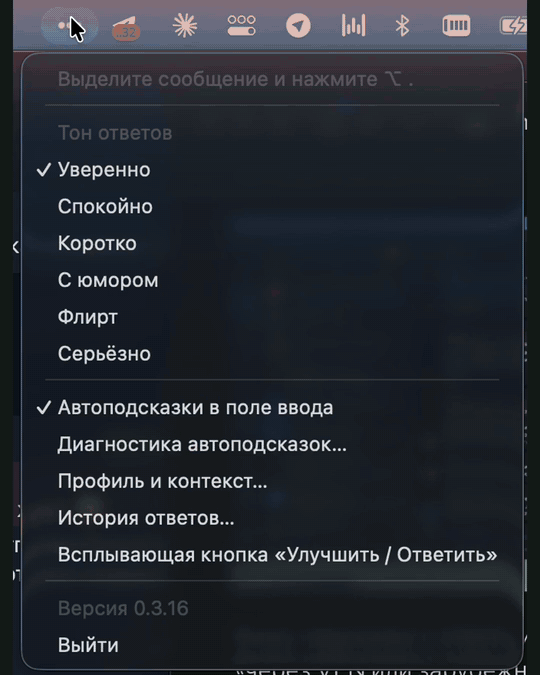

**Автоподсказки ответа в любом чате. Ставите курсор в пустое поле — серым
появляется ответ на последнее сообщение, в вашем стиле. Tab вставляет,
отправляете сами.**

Как подсказки в Codex, только в Telegram, Slack, Discord, браузере — и в самом Codex.

## Скачать

&nbsp;

Кнопки ведут прямо на файлы последней версии. Дальше приложение на Mac обновляется само.

**macOS.** Перенесите Троеточие в «Программы» и запустите. Пока сертификат Apple в пути, macOS может сказать «неизвестный разработчик»: «Системные настройки» → «Конфиденциальность и безопасность» → «Всё равно открыть». Затем выдайте два разрешения:

- **Универсальный доступ** — видеть поле ввода и вставлять ответ;
- **Запись экрана** — читать переписку там, где приложение не отдаёт текст иначе (например, Telegram Desktop).

**Windows 0.3.38, 10+ x64.** Установщик ставится без прав администратора. SmartScreen может предупредить о неизвестном издателе. В выпуск перенесены сценарии переписки в меню, словарь исправлений, профиль стиля и список установленных программ в настройках подсказок. Ctrl+Alt+S переключает сценарии, Ctrl+Alt+T включает и выключает подсказки, Ctrl+Alt+X меняет их доступность в текущем приложении. При выборе собеседника в учебном чате поле сообщения получает фокус автоматически. Всплывающая кнопка «Улучшить» по умолчанию выключена и включается в настройках. Обновления загружаются и проверяются в фоне, установка запускается по подтверждению пользователя.

## Как это работает

1. **Курсор в пустое поле.** Троеточие читает видимую переписку над полем и за секунду готовит ответ.
2. **Серый текст.** Ответ появляется прямо в поле — шрифтом и цветом самого приложения.
3. **Tab.** Вставляет ответ. Любая другая клавиша убирает подсказку. Кнопку «отправить» нажимаете вы.

Если на сообщение нужно личное решение («ты свободен в субботу?»), подсказка не появляется — такие ответы за вас не пишем.

## Где работает

| Приложение | macOS | Windows |
|---|:---:|:---:|
| Telegram, Telegram Desktop | ✅ | ✅ |
| Discord | ✅ | ✅ |
| Slack, TrueConf | ✅ | — |
| Codex, Cursor | ✅ | — |
| Блокнот Windows | - | ✅ |
| Поля сообщений в браузере | ✅ | Проверяется |

В Windows отдельный случай отказа Tab в Chrome/VK с тёмной темой пока не воспроизведён. Он не объявлен исправленным в 0.3.38.

В работе: Apple Mail, Outlook, Spark, Zoom, MAX, VK Teams, Signal. Подсказки в поле — на macOS 14 и новее; на macOS 12–13 работает окно вариантов.

## Что ещё умеет

- **Три варианта по сочетанию клавиш** — уверенно, спокойно, коротко, с юмором.
- **«Улучшить»** — переписать черновик, не меняя смысла.
- **Ваш стиль** — обращение, длина, эмодзи и скобочки берутся из того, как пишете вы.
- **Обновляется само** на Mac.

## Приватность

- Читаем только видимую переписку над полем, в котором вы сейчас пишете, и только пока поле в фокусе.
- Снимки экрана обрабатываются на устройстве; на сервер уходит текст для одного ответа.
- Переписку не храним. Пароли, поиск, платёжные поля и окна с ключами исключены.

## Обратная связь

Не появилась подсказка или ответ вышел странным — [откройте issue](../../issues/new): какое приложение, версия Троеточия и что было в переписке.

**[troetochie.online](https://troetochie.online)**

