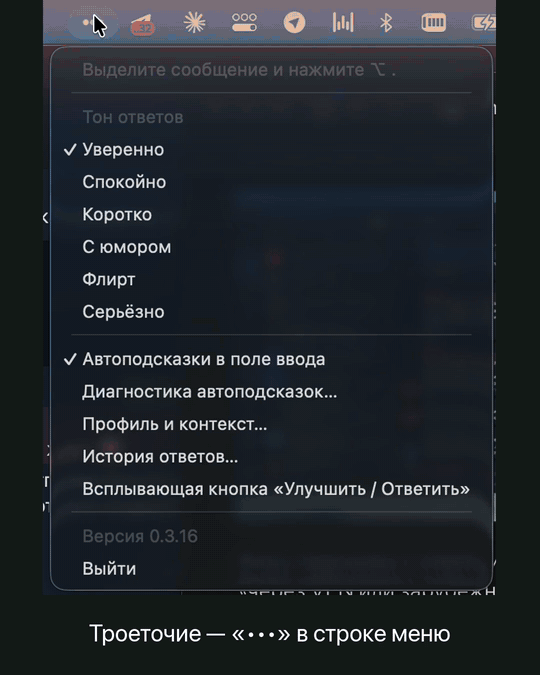

# Троеточие

**Автоподсказки ответа в любом чате на Mac.** Ставите курсор в пустое поле — серым появляется ответ на последнее сообщение, написанный в вашем стиле. Tab вставляет, любая клавиша убирает. Отправляете всегда вы.

Как подсказки в Codex, только в Telegram, Slack, Discord, браузере и самом Codex.

## Где работает

Проверено вживую:

- Telegram и Telegram Desktop
- Slack, Discord, TrueConf
- Codex, Cursor
- Поля сообщений в Chrome, Safari, Firefox, Edge, Яндекс Браузере, Brave, Opera, Vivaldi

В работе: Apple Mail, Outlook, Spark, Zoom, MAX, VK Teams, Signal.

## Установка

1. Скачайте [Troetochie.dmg](https://troetochie.online/downloads/Troetochie.dmg) или из [Releases](../../releases/latest) и перенесите Троеточие в «Программы».
2. Запустите и пройдите знакомство: выберите, с кем переписываетесь, и стиль ответов.
3. Выдайте два разрешения в «Системные настройки» → «Конфиденциальность и безопасность»:
   - **Универсальный доступ** — чтобы видеть поле ввода и вставлять ответ;
   - **Запись экрана** — чтобы читать переписку в приложениях, которые не отдают текст иначе (например, Telegram).

Нужна macOS 14 или новее для автоподсказок; на macOS 12–13 работает окно вариантов по сочетанию клавиш. Обновления приходят сами.

## Что ещё умеет

- **Окно вариантов по сочетанию клавиш:** три ответа разным тоном — уверенно, коротко, с юмором или своим тоном.

  

- **«Улучшить»:** переписать черновик, не меняя смысла.
- **Ваш стиль:** обращение, длина, эмодзи и скобочки берутся из того, как вы пишете.

## Приватность

- Читаем только видимую переписку над полем, в котором вы сейчас пишете, и только когда поле в фокусе.
- Снимки экрана обрабатываются на Mac и никуда не отправляются; на сервер уходит текст для одного ответа.
- Переписку не храним. Пароли, поиск, платёжные поля и окна с ключами доступа исключены.

## Обратная связь

Нашли приложение, где подсказки не появляются, или ответ получился странным — откройте [issue](../../issues/new) и укажите приложение и версию Троеточия.

Исходный код приложения закрыт: этот репозиторий для релизов, отзывов и запросов на поддержку новых приложений.

Сайт: [troetochie.online](https://troetochie.online)
